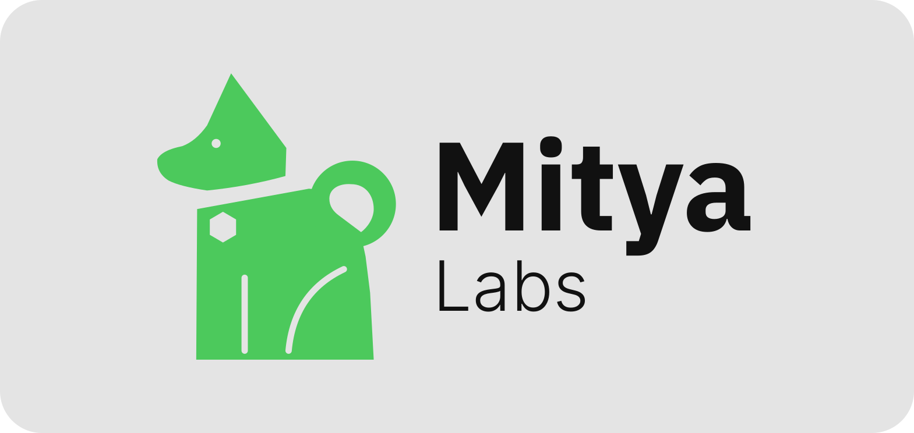
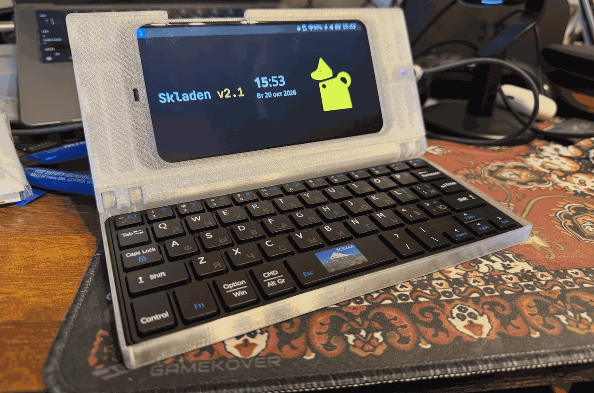
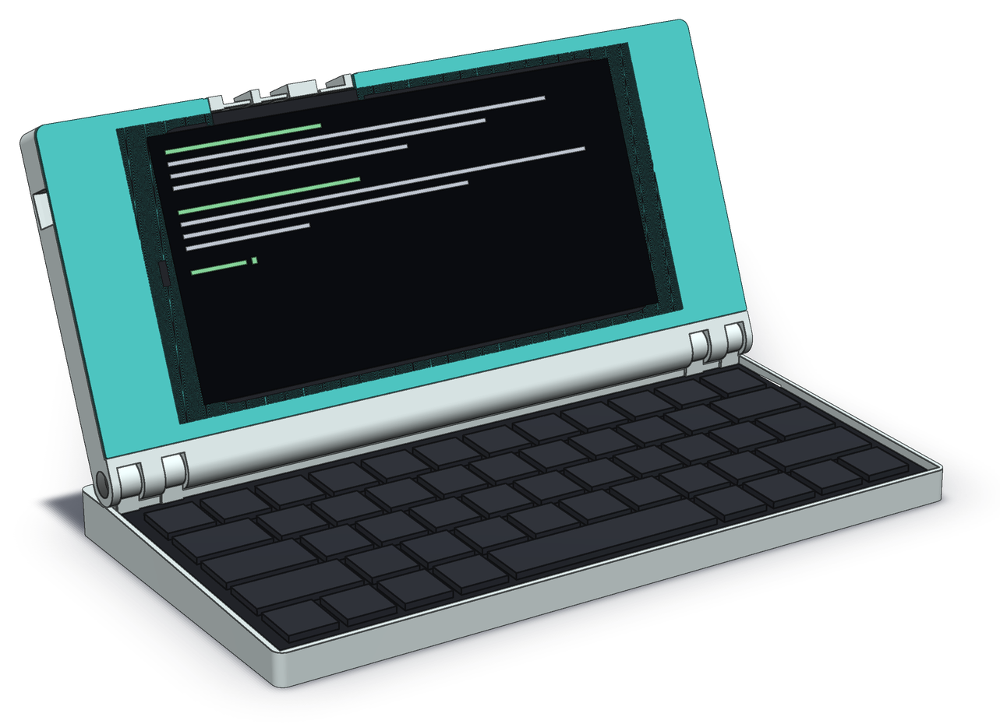
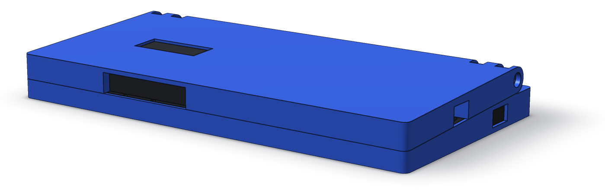

<p align="center">
  
</p>

<p align="center"><a href="README.md">English</a> · <b>Русский</b> ·
<a href="CHANGELOG.md">Changelog</a> · <a href="#версии">Версии</a></p>

# Mitya Computer Skladen 2

Раскладушка, которая превращает Xiaomi Pocophone F1 в карманный терминал в форме
ноутбука. Название — *складень*: дорожная икона на петлях, две створки, которые
смыкаются над тем, что в них лежит.

Skladen 2 — это конструкция Mk3 (Pixel 3a XL, клавиатура Jomaa KEYBOARD098RU из
чехла-книжки), пересчитанная под другой телефон. **Клавиатура, основание, петли и
толкатель выключателя не изменились.** Изменилась крышка:

- карман, радиусы углов, окно кнопок и вырез камеры сделаны под Pocophone F1 по
  модели `refs/fun.fbx`;
- **новое: паз в левом торце крышки под 3,5 мм разъём наушников телефона**;
- телефон толще на 0,6 мм и тяжелее на 15 г, поэтому сложенное устройство толще, а
  бюджет массы сдвинулся — см. [ADR-0011](docs/adr/0011-phone-swap-pocophone-f1.md).

<p align="center">
  
  <br>
  <sub>Skladen 2.0.0, напечатан и собран.</sub>
</p>

<p align="center">
  
  <br>
  
  <br>
  <sub>В сложенном виде: 24,29 мм у петли, 20,31 спереди. Оба рендера получены прямо из
  модели через <code>cad/render.py</code>; телефон и клавиатура — заглушки по
  измеренным габаритам.</sub>
</p>

## Версии

Эта ветка (`main`) — **Skladen 2**. Предыдущие версии доступны по тегам; что менялось,
написано в [CHANGELOG.md](CHANGELOG.md).

| Версия | Что | Где |
|---|---|---|
| **2.1** (не выпущена) | Skladen 2 с рамкой на защёлках; смоделирована, не напечатана | эта ветка, `export/bezel/` |
| **2.0.0** | Skladen 2: Pocophone F1, телефон на скотче; напечатан | [тег v2.0.0](https://github.com/DmitriiTrifonov/skladen/tree/v2.0.0) |
| **1.0.0** | Skladen 1 / Mk3: Pixel 3a XL; напечатан | [тег v1.0.0](https://github.com/DmitriiTrifonov/skladen/tree/v1.0.0), [его README](https://github.com/DmitriiTrifonov/skladen/blob/v1.0.0/README.md), ветка [`v1`](https://github.com/DmitriiTrifonov/skladen/tree/v1) |

Версии по семантическому версионированию для железа: новый major — когда детали перестают
подходить друг к другу (другой телефон), minor — совместимая опция вроде рамки.

## Состояние

**Версия 2.0.0 напечатана, собрана и работает** (фото выше); рамка спереди в
`export/bezel/` — более позднее предложение, смоделированное, но ещё не напечатанное;
см. [Версии](#версии).
`cad/build.py` строит обе
половины и проходит все проверки: каждая деталь — одно тело, нет пересечений в
сложенном виде и при раскрытии 0–180°, болты петель достижимы, толкатель выключателя
не задевает, путь штекера из USB-C и разъёма наушников свободен. Проверить сам
телефон он не может. Толщина кармана, 9,25 мм, — замер штангенциркулем
владельца; по спецификации 8,8, в FBX 7,9. Высота в сложенном виде теперь
в 0,21 мм от предела 24,5, а запас от опрокидывания — 1,00.

Бюджет массы N4 поднят с 400 до 420 г (оценка ~403 г; одобрено владельцем,
[ADR-0011](docs/adr/0011-phone-swap-pocophone-f1.md)).

Результаты печати Mk3 (купоны петель с двумя дефектами, первая полная печать) —
это унаследованные уроки. Skladen 2.0.0 после этого напечатан, но числа ниже —
модельные, а не замеры с этой печати.

| | Mk3 | Skladen 2 |
|---|---|---|
| Телефон | Pixel 3a XL, 160,1 × 76,1 × 8,2, 167 г | Pocophone F1, 155,5 × 75,3 × 9,25, 182 г |
| Сложен, сзади / спереди | 23,24 / 19,26 мм | **24,29 / 20,31 мм** |
| Запас до предела 24,5 | 1,26 | **0,21** |
| Масса печати (оценка) | ~386 г | ~403 г |
| Запас от опрокидывания при 180° (оценка) | 1.08 | 1,00 (держит на бумаге, запаса нет) |
| Разъём наушников | без выреза | паз 9 × 8 |

| Документ | Что это |
|---|---|
| [requirements.md](docs/requirements.md) | Цели, ограничения, критерии приёмки (на английском) |
| [measurements.md](docs/measurements.md) | Все числа с оценкой достоверности; раздел о телефоне — Skladen 2 |
| [adr/0011](docs/adr/0011-phone-swap-pocophone-f1.md) | Что изменилось относительно Mk3 и почему |
| [parameters.md](docs/parameters.md) | Все определяющие размеры, генерируется из `cad/params.py` |
| [analysis/](docs/analysis/) | Толщина, баланс, геометрия раскладушки — **от Mk3**, без правок |
| [plan.md](docs/plan.md) | Этапы и риски — от Mk3 |
| [adr/](docs/adr/README.md) | Четырнадцать проектных решений; 0001–0010 — от Mk3, 0012–0014 — предложения |
| [sourcing.md](docs/sourcing.md) | Ссылки: сборка с Reddit, откуда взялись 0012/0013, кандидаты на ту же клавиатуру, что измерить (на английском) |

## Предложено, смоделировано, не напечатано

Две идеи из сборки Boox Palma с Reddit, оформлены как предложения:

- **Рамка на защёлках вместо скотча** ([ADR-0012](docs/adr/0012-removable-front-bezel.md)):
  пластина 0,8 мм на весь перед крышки с окном под экран и вырезом над кнопками телефона,
  пятнадцать защёлок без винтов, торцы крышки выбраны. Закрытая высота остаётся 24,29.
  Массы по слайсеру: крышка 56,0 г, рамка 6,35 г, основание 56,5 г; запас от опрокидывания
  1,154 на 150° и 1,000 на 180°. Лежит в `export/bezel/`; `export/device/` не тронут.
- **Короткий USB-C удлинитель, остающийся в телефоне** ([ADR-0013](docs/adr/0013-usbc-extender.md)):
  изнашивается он, а не порт телефона. Паз USB-C в крышке углублён до 9,0 мм; размер адаптера
  (ширина не больше 11,5, длина около 28) указан в ADR.

## Что унаследовано от Mk3

**Ни один компонент тоньше не становится, поэтому убирали оболочки.** Корпус
клавиатуры 9,52 мм, телефон 9,25; вместе это большая часть бюджета, и оба не
обсуждаются. Остались две оболочки — пол основания и спинка крышки; обе оставлены
ради закрытости ([ADR-0008](docs/adr/0008-base-floor.md),
[ADR-0004](docs/adr/0004-phone-retention.md)).

**Петля печатная, не покупная:** печатные проушины на двух болтовых стойках M3, где
болт задаёт прогиб, а упругая шайба — усилие
([ADR-0005](docs/adr/0005-hinge-mechanism.md),
[ADR-0010](docs/adr/0010-hinge-station-count.md)).

**Опрокидывание решает геометрия, а не балласт:** вынос назад на 15 мм, на нём же
стоят стойки петель ([ADR-0003](docs/adr/0003-lid-balance-strategy.md)). С более
тяжёлым телефоном этот запас стал тонким; см. ADR-0011.

## Структура

```
refs/          модель телефона, с которой сняты числа (fun.fbx)
docs/          требования, измерения, анализы, ADR
docs/img/      рендеры из cad/render.py
cad/           модель на build123d: params.py управляет, build.py проверяет и экспортирует
cad/logo/      исходники логотипа, из которого вырезаются вставки в крышке
export/device/    STL и STEP устройства: крышка + основание (гайка DIN 985 с нейлоном)
export/plainnut/  основание под обычную гайку DIN 934 + фиксатор резьбы; крышка из device/
export/coupon21/  купоны стойки петли; в купоне основания ещё и паз выключателя
export/coupon-phone/  левый конец крышки: паз джека, вырез камеры, окно кнопок и угол
                  кармана — примерить настоящий телефон до печати всей крышки
export/bezel/     предложение: крышка под рамку на защёлках (полые торцы, без скотча) и сама
                  рамка, плюс плоский STL рамки для печати (ADR-0012). Крышка с логотипом —
                  двухцветный проект Bambu, `...-logo-petg.3mf`, пересобираемый
                  из `cad/templates/` (см. ADR-0012)
export/switch-window/  предложение: основание с окошком в заднем торце и пробка к нему
                  (ADR-0014); `export/skladen2-2.1-plates.3mf` — все столы 2.1 одним проектом
export/switch/    толкатель выключателя клавиатуры с задней стенки:
                  три длины пальцев на пять длин штока — печатать набор, оставить подошедший
export/logo/      логотип Mitya Computer: lid-logo (с выемкой) + зелёная вставка
                  для печати двумя филаментами
```

Пересборка: `python3.12 -m venv .venv && .venv/bin/pip install build123d==0.12.0`,
затем `.venv/bin/python cad/build.py`, а `cad/render.py` — для картинок.

## Лицензия

Copyright Dmitrii Trifonov 2026.

Проект — модель в `cad/`, экспортируемые из неё файлы и документация — распространяется
под [CERN Open Hardware Licence Version 2 – Strongly Reciprocal](LICENSE)
(CERN-OHL-S-2.0). По этой лицензии исходником проекта является Python-модель: если
вы её адаптируете — скажем, под другой телефон или клавиатуру — и распространяете
результат или что-либо сделанное по нему, вы делитесь изменённым исходником на тех же
условиях.

**Кроме названия и логотипа Mitya Computer.** Графика в `cad/logo/` и
`docs/img/mitya-computer.svg`, а также логотип, который из неё попадает в `export/logo/`,
под эту лицензию не подпадают: все права защищены. Они лежат в репозитории, чтобы
крышку можно было собрать с ними, а не для повторного использования. Устройство,
которое вы изготавливаете и распространяете по этому проекту, должно использовать
простую крышку из `export/device/`, без логотипа, или крышку со своим логотипом.

Этот перевод — для удобства; юридически значим английский текст лицензии.

Исходники: <https://github.com/DmitriiTrifonov/skladen>
